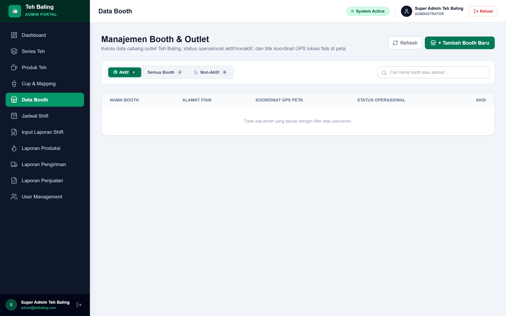
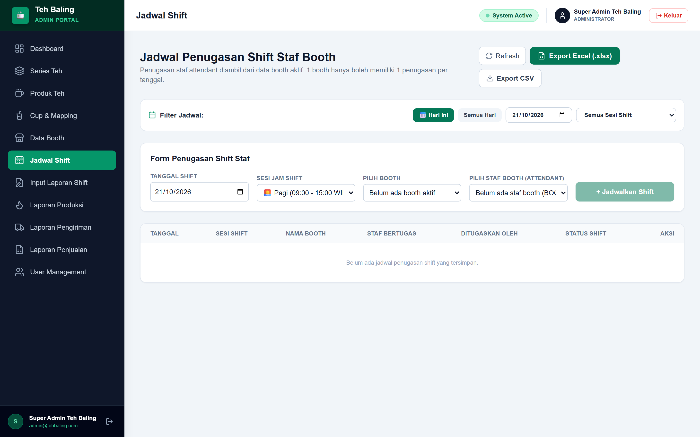

# Teh Baling — Backend API & ERP Engine

Backend REST API berkinerja tinggi untuk sistem operasional jaringan franchise booth minuman **Teh Baling**. Dibangun menggunakan arsitektur modern berbasis **Hono.js**, **TypeScript**, **Drizzle ORM**, dan **PostgreSQL**.

Frontend terkait: [teh-baling-frontend](https://github.com/Salman-artz/teh-baling-frontend).

---

## 📸 Fitur Kunci & Integrasi Sistem

<p align="center">
  
  <br/>
  <em>Manajemen Data Titik Koordinat Booth & Status Operasional Outlet (GIS)</em>
</p>

<p align="center">
  
  <br/>
  <em>Verifikasi Presensi Barista dengan Validasi Radius Lokasi GPS (Formula Haversine 200m)</em>
</p>

---

## ✨ Fitur Backend

- **Autentikasi & Otorisasi RBAC**: Autentikasi JWT stateless dengan verifikasi role (Admin, Barista, Staff Gudang).
- **Presensi Geofencing GPS**: Validasi kehadiran menggunakan formula matematika **Haversine** untuk menghitung jarak akurat antara koordinat device dan titik GPS booth.
- **Audit Stok Cup & Mutasi Harian**: Perekaman mutasi inventaris bahan baku & cup teh untuk mencegah kebocoran operasional.
- **Ekspor Laporan Excel Otomatis**: Generate laporan penjualan dan rekonsiliasi stok dalam format `.xlsx` menggunakan **ExcelJS** dengan proteksi formula injection.
- **Database Type-Safe**: Menggunakan **Drizzle ORM** dan PostgreSQL dengan schema migration otomatis.

---

## 🛠️ Tech Stack

- **Runtime / Framework**: [Hono.js](https://hono.dev/) & Node.js
- **Language**: [TypeScript](https://www.typescriptlang.org/)
- **ORM**: [Drizzle ORM](https://orm.drizzle.team/)
- **Database**: [PostgreSQL](https://www.postgresql.org/)
- **Laporan**: [ExcelJS](https://github.com/exceljs/exceljs)
- **Validation**: [Zod](https://zod.dev/)

---

## 🚀 Menjalankan Project

### 1. Instalasi Dependensi
```bash
pnpm install
```

### 2. Setup Database & Migrasi
```bash
cp .env.example .env
# Sesuaikan DATABASE_URL di file .env

pnpm db:push
pnpm db:seed
```

### 3. Jalankan Server Development
```bash
pnpm dev
```
Server berjalan secara default pada `http://localhost:3001`.

---

## 👤 Author

**Muhammad Salman Alfarizy Yonda Putra**
- GitHub: [@Salman-artz](https://github.com/Salman-artz)
